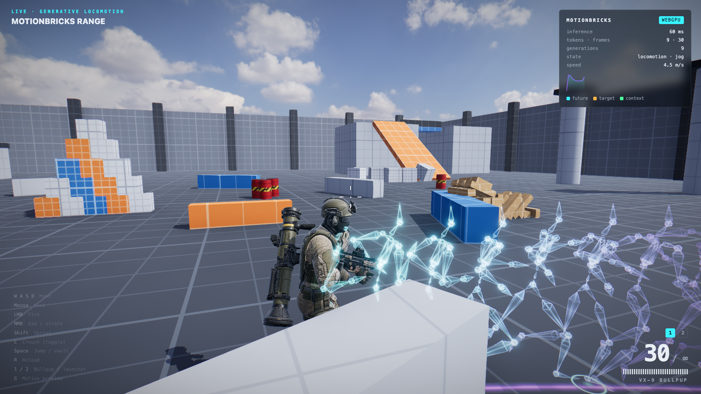

# MotionBricks Range

A third-person shooter prototype whose special forces operator is animated **live, in the browser** by [NVIDIA MotionBricks](https://github.com/NVlabs/motionbricks), a 200M-parameter generative motion model. Everything runs on the page: the ONNX model runs on WebGPU (with a WASM fallback), physics runs on Rapier, and rendering uses three.js. There is no server.



The cyan-to-violet wireframes show what MotionBricks just generated: the operator's next 1–2 seconds of motion. Amber is the target pose the model is steering toward, green is the context it was conditioned on, and rings mark predicted footfalls.

## Running it

```bash
npm install
npm run setup      # downloads the MotionBricks model (~380 MB), sample clips and HDRI sky; optimizes the character
npm run dev        # http://localhost:5173
```

Use a recent Chromium browser for WebGPU. Other browsers fall back to multithreaded WASM, which is slower; add `?backend=wasm` to force that path. The model is cached in the browser after the first load.

| Input | Action |
| --- | --- |
| `W A S D` | Move (camera-relative) |
| Mouse | Look |
| `LMB` | Fire |
| `RMB` | Aim; the operator strafes and faces the crosshair |
| `Shift` | Sprint |
| `C` | Crouch toggle (combat crouch; walk or aim-walk while crouched) |
| `Space` | Jump, or vault a low obstacle ahead (0.25–1.05 m) |
| `R` | Reload |
| `1` / `2` / wheel | Bullpup rifle / rocket launcher |
| `G` | Toggle the motion preview |
| `H` | Toggle the HUD |

Things to shoot include crates that splinter, red barrels that explode (and set each other off), hinged steel plates and cans on the range, glass panes, a cube pyramid, and a plank tower.

## How the operator moves

The code in `src/motion/` is a TypeScript port of the MotionBricks SOMA runtime.

1. **Engine** (`engine.ts`) encodes four context poses and one to four target poses into the model's tensors. It aligns them by heading, computes root velocities and 6D rotations, and runs the ONNX graph. It then decodes the generated frames and applies endpoint correction, so the motion starts exactly where the character is and ends on the target. It matches the Python reference to within millimetres; see the integration test.
2. **Player** (`player.ts`) plays generations back and records every displayed pose. The last 0.1 s of that history becomes the next generation's context. Inference is asynchronous, so a new generation starts at the elapsed latency and crossfades in.
3. **Locomotion** (`locomotion.ts`) follows the Scene Preview runtime. Targets are blended from sample-clip windows in two blend spaces:
   - a speed space for walking, jogging and sprinting
   - a direction space for aimed movement, with a walk pose forward

   Each target is placed about a second ahead along a spring-smoothed desired velocity, and each generation spans 8–14 tokens. Shorter spans react sooner but can't fit a whole stride, so the gait shuffles; `gait.test.ts` guards that trade-off. A new generation is requested on turns, speed changes, or when the current motion runs out. Standing still is a generated transition into an idle clip, and turning in place is a generated turn.

   Vaulting and jumping follow MotionBricks' `jump_0_75m` Smart Primitive: three target windows from a no-hands hurdle clip (run-up, apex over the obstacle, run-out), placed on the obstacle the player is running at.
4. **Physics** (`src/game/player.ts`) moves a Rapier kinematic capsule along the generated root path. Whatever the world blocks is pushed back into the motion, so the next generation starts from where the operator actually is. A light input assist also nudges the capsule toward the requested velocity. That extra displacement is folded back into the motion, so WASD responds immediately while the animation catches up.
5. **Retargeting** (`src/character/retarget.ts`) maps the 77-joint SOMA skeleton onto the Mixamo-rigged operator, using a per-bone frame calibration that tolerates different bind poses. `soldier.ts` then layers on top of it:
   - an aim layer that twists the spine toward the crosshair and shoulders the carbine
   - two-bone IK that keeps both hands on the carbine
   - a procedural combat crouch: the hips drop, and leg IK keeps the feet where MotionBricks planted them

## Project layout

```
src/
  main.ts            loading, wiring, frame loop
  motion/            MotionBricks port: BVH, skeleton math, engine, playback, locomotion
  character/         retargeting, IK, the operator, weapon definitions (grips, stances, fire)
  game/              input, camera rig, player character, weapon
  world/             Rapier wrapper, grey-box level, shootable props
  fx/                motion-preview holograms, particles, tracers/decals/flashes
  render/            renderer + post stack (N8AO, bloom, ACES, SMAA), grid material
  ui/                splash + HUD
  audio.ts           procedural WebAudio sound effects
scripts/             fetch-assets.mjs, optimize-models.mjs, assets/ (AI asset generation)
tools/               asset-viewer.html (review / measure GLBs)
assets-src/models/   source GLB (+ attribution)
public/              generated: models/, motionbricks/, hdri/ (gitignored)
```

## The operator and his weapons

The character, the bullpup rifle and the compact rocket launcher are all generated for this project. Each starts as an AI reference image, becomes a Tripo 3D mesh, and the character is then auto-rigged by Tripo. See `scripts/assets/generate.mjs` and `assets-src/models/README.md`. The operator holds whichever weapon is out and slings the other across his back:

- **Rifle:** the cheek weld puts the optic in front of his eye.
- **Launcher:** the tube rests on his shoulder.
- **Grips:** two-bone IK flexes each elbow about its real hinge and keeps both hands on the grips, with fingers curled around them.
- **Launcher rockets:** a smoke trail and a backblast, and an explosion on impact that sets off barrels nearby.

## Look

The scene is lit by an HDRI sky (Poly Haven, CC0). Its sun direction, sun colour and horizon fog are all read from the image, and the image also supplies the image-based lighting. Additional touches:

- a fresnel rim light that lifts the operator off the background
- a mesh muzzle flash, ejected brass and a laser sight
- noise-shaded fire and smoke
- shockwave rings and scorch marks

## Tests

`npm test` runs the MotionBricks port against the real model in Node with onnxruntime-node. It checks inbetweening fidelity against a real clip and steers locomotion along a path. It also measures gait quality for every movement mode (footfall order, step evenness and hip bounce) and start, stop and turn responsiveness. The tests skip if `npm run setup` has not been run.

## Licensing

- Code: MIT, see [`LICENSE`](./LICENSE).
- MotionBricks models: [NVIDIA Open Model Agreement](https://www.nvidia.com/en-us/agreements/enterprise-software/nvidia-open-model-agreement/). The sample BVH clips are under the NVIDIA Sample Data Evaluation License, for evaluation only. Both are downloaded by `npm run setup` and are not committed.
- The operator, rifle and launcher are generated for this project with OpenAI GPT Image and Tripo 3D. See [`assets-src/models/README.md`](./assets-src/models/README.md) and [`metadata.json`](./metadata.json).
- The sky is [Kloofendal 48d Partly Cloudy (Pure Sky)](https://polyhaven.com/a/kloofendal_48d_partly_cloudy_puresky) by Greg Zaal, from Poly Haven, CC0. It is downloaded by `npm run setup`.
